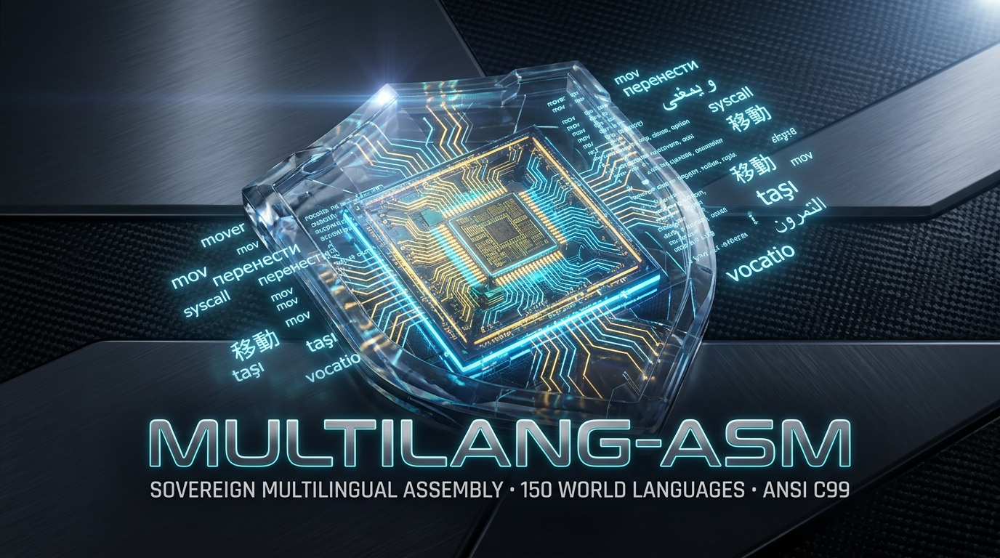

# 🛡️ MultiLang-ASM v1.0.0
<p align="center">
  
</p>

> *"No saber inglés no debería impedirte crear. La imaginación no tiene idioma y la máquina solo entiende binario."*

**El primer motor de ensamblador x86_64 soberano y multilingüe del mundo.**  
Parte fundamental del ecosistema **UPL (Universal Polyglot Layer)** y del núcleo de **Neuro-OS**.

Escribe código ensamblador en tu lengua materna · 150 Idiomas del Mundo · 200+ Instrucciones x86_64 Canónicas · Motor Nativo 100% ANSI C99 · Cero Dependencias de Runtime · Ejecución Instantánea (<2 ms) · Compatible con NASM/FASM/GAS.

[](LICENSE)
[](src/)
[](LISTA_PAISES_LENGUAS.md)
[](docs/INSTRUCCIONES_ES.md)
[](https://github.com/cyberenigma-lgtm/UNIVERSAL-POLYGLOT-LAYER-UPL)

📖 **[Español](README_ES.md)** | **[English](README.md)** | **[Français](README_FR.md)** | **[Deutsch](README_DE.md)** | **[Italiano](README_IT.md)** | **[Português](README_PT.md)** | **[Русский](README_RU.md)** | **[日本語](README_JA.md)** | **[中文](README_ZH.md)** | **[한국어](README_KO.md)** | **[العربية](README_AR.md)** | **[Bahasa](README_ID.md)** | **[Hindi](README_HI.md)** | **[Türkçe](README_TR.md)** | **[Polski](README_PL.md)** | **[Svenska](README_SV.md)** | **[Nederlands](README_NL.md)**

---

## 🚀 ¿Qué es MultiLang-ASM?

MultiLang-ASM es un transpilador y preprocesador de ensamblador x86_64 ultra-rápido y sin dependencias.  
Permite a desarrolladores de sistemas, estudiantes, creadores de kernels y firmware escribir ensamblador utilizando palabras clave en su idioma nativo, traduciéndolo de forma instantánea a código NASM estándar.

Habiendo comenzado como un prototipo en Python, **la versión 1.0.0 ha sido reescrita íntegramente como un motor nativo ANSI C99**, eliminando todo requisito de Python en tiempo de compilación y ejecución, logrando tiempos de traducción inferiores a 2 milisegundos.

### Ejemplo Bidireccional (Español ↔ NASM Estándar)

```asm
; Entrada en Español (examples/hello_es.masm)
mover rax, 1
mover rdi, 1
mover rsi, mensaje
mover rdx, 13
llamada_sistema

; Salida transpilada instantáneamente → NASM Estándar
mov rax, 1
mov rdi, 1
mov rsi, mensaje
mov rdx, 13
syscall
```

---

## ✨ Novedades y Características (v1.0.0 Estándar UPL+)

- ⚡ **Motor 100% Nativo en ANSI C99**: Cero dependencias externas. Compilable con cualquier compilador estándar C99 (`gcc`, `clang`, `tcc`, `msvc`). Binario de menos de 80 KB.
- 🌍 **150 Idiomas y Dialectos del Mundo**: Cobertura completa de los 5 continentes (Europa, América, África, Asia y Oceanía), incluyendo lenguas indígenas y regionales.
- ⚙️ **200+ Instrucciones Canónicas**: Soporte exhaustivo para todo el repertorio x86_64: transferencia de datos, aritmética, lógica, manipulación de bits, banderas de control, cadenas, bucles, llamadas de sistema, tablas de descriptores (GDT/IDT/LDT) y operaciones FPU/x87.
- 🤖 **Auto-Detección Instantánea de Idioma**: MultiLang-ASM analiza el código fuente e identifica automáticamente la lengua utilizada (`mlasm auto archivo.masm`).
- 🔁 **Modo Inverso Reversible (PRETTY)**: Permite visualizar código NASM estándar en cualquiera de los 150 idiomas soportados (`--reverse`).
- 🧠 **Preprocesador de Macros Nativo**: Soporte en C para `%define NOMBRE valor`.
- 🛡️ **Arquitectura Pass-Through**: Toda instrucción x86 no registrada explícitamente se transfiere directamente a NASM sin alteraciones.
- 📦 **Compilación Directa (`--build`)**: Transpila, ensambla con NASM y enlaza con GCC en un solo paso (`mlasm --build es archivo.masm`).

---

## 🛠️ Instalación y Uso Rápido

### 1. Compilación del Motor Nativo

**En Windows:**
```cmd
gcc -std=c99 -Wall -Wextra -O2 src/mlasm_core.c -I src -o bin/mlasm.exe
```
*(O ejecuta directamente `mlasm.bat`, que compila el binario automáticamente en el primer inicio).*

**En Linux / macOS:**
```bash
make
# o: gcc -std=c99 -Wall -Wextra -O2 src/mlasm_core.c -I src -o bin/mlasm
```

### 2. Comandos Principales

```bash
# Transpilación básica con especificación de idioma:
mlasm es examples/hello_es.masm -o bin/hello_es.asm

# Auto-detección inteligente del idioma:
mlasm auto examples/hello_zh.masm -o bin/hello_zh.asm

# Modo inverso (NASM estándar -> Idioma nativo):
mlasm --reverse es bin/hello_es.asm -o bin/hello_invertido.masm

# Compilar directo a ejecutable binario (.exe):
mlasm --build es examples/hello_es.masm

# Ejecutar suite de pruebas internas:
mlasm --test

# Listar los 150 idiomas soportados:
mlasm --list-langs
```

---

## 🗺️ Cobertura Lingüística (150 Lenguas)

Consulta el [Directorio Oficial de Países y Lenguas (LISTA_PAISES_LENGUAS.md)](LISTA_PAISES_LENGUAS.md) para ver la lista completa categorizada por continentes:
- **Europa (46 lenguas)**: Español, Catalán, Gallego, Euskera, Asturiano, Aragonés, Occitano, Bretón, Francés, Alemán, Italiano, Portugués, Inglés, Irlandés, Gaélico Escocés, Galés, Neerlandés, Danés, Sueco, Noruego, Islandés, Feroés, Finlandés, Estonio, Letón, Lituano, Polaco, Checo, Eslovaco, Húngaro, Rumano, Búlgaro, Serbio, Croata, Bosnio, Esloveno, Macedonio, Albanés, Griego, Maltés, Bielorruso, Ruso, Ucraniano, Latín, Esperanto.
- **América (16 lenguas)**: Variantes dialectales de Español americano, Quechua, Aimara, Náhuatl, Maya, Guaraní, Cheroqui, Navajo, Inuktitut, Groenlandés, Hawaiano, etc.
- **África (36 lenguas)**: Suajili, Amárico, Oromo, Tigriña, Somalí, Hausa, Yoruba, Igbo, Fula, Wolof, Akan, Lingala, Kongo, Kinyarwanda, Kirundi, Shona, Chichewa, Zulú, Xhosa, Afrikaans, etc.
- **Asia y Oceanía (52 lenguas)**: Chino Mandarín, Cantonés, Japonés, Coreano, Vietnamita, Tailandés, Jemer, Birmano, Indonesio, Javanés, Tagalo, Cebuano, Hindi, Urdu, Bengalí, Panyabí, Maratí, Guyaratí, Tamil, Telugu, Canarés, Malayalam, Persa, Pashto, Kurdo, Hebreo, Árabe, Turco, Kazajo, Uzbeko, Mongol, Maorí, Samoano, Fiyiano, Tok Pisin, etc.

---

## 🧪 Pruebas y Validación

El repositorio cuenta con scripts de validación nativos:
```bash
# En Windows:
test.bat

# En Linux o macOS:
./test.sh
```
Todas las pruebas de integridad mnemónica, macros, modo reversible y auto-detección se ejecutan en menos de 5 milisegundos con 0 errores.

---

## 📜 Filosofía de Soberanía Tecnológica

> *"Las herramientas de bajo nivel han sido diseñadas históricamente bajo una barrera idiomática anglocéntrica. MultiLang-ASM y UPL devuelven la soberanía a cada pueblo: la máquina ejecuta binario; el ser humano programa en su lengua nativa."*

MultiLang-ASM es software libre de código abierto bajo la **Licencia MIT**.  
Diseñado como parte del ecosistema soberano **UPL (Universal Polyglot Layer)** y **Neuro-OS**.
